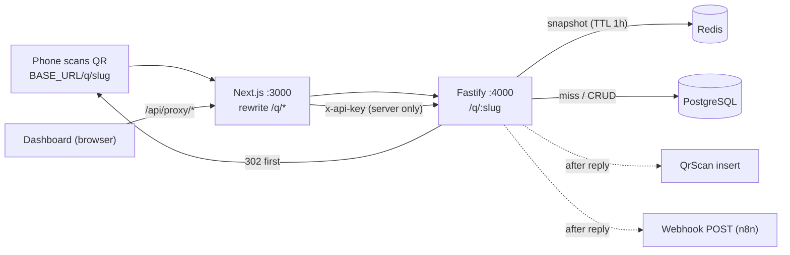

# QIRA QRs Pro — Dynamic QR & Print Card Studio

Full-stack TypeScript monorepo implementing [`SRS.md`](./SRS.md).

```
apps/
  web/        Next.js 15 (App Router) — dashboard, QR editor, Print Studio, batch, analytics, /p/:slug landings
  api/        Fastify 5 — REST API (/api/v1), redirect engine (/q/:slug), assets, analytics
packages/
  shared/     Pure domain logic (no I/O): slugs, URL sanitizing, routing rules, redirect resolution,
              contrast checker, cm↔px/pt units, sheet imposition, CSV/templates, vCard, zod schemas
  db/         Prisma schema + client (PostgreSQL)
docs/API.md   API contract shared by web and api
```

## Architecture in one picture



Key decisions:

- **The QR payload is always `{BASE_URL}/q/{slug}`** and the slug is immutable, so editing destinations/rules never changes the printed matrix (RF-01.2).
- **Redirect decisions are a pure function** (`resolveRedirect` in `packages/shared`) — trivially unit-testable; the API only adds I/O (cache, DB, tracking, webhooks) around it.
- **Card geometry is stored in centimetres**, never screen pixels. Every export renders off-screen at exactly `px = round(cm / 2.54 × 300)` (RF-03.2, RNF-02).
- **Batch rendering runs in the browser** with the same Konva renderer as single exports (no native `canvas` dependency on the server). The API creates the N QR records; the client renders the N cards and builds the ZIP/PDF.
- **PDF output** has exact physical size in points with TrimBox/BleedBox and vector cut marks; the artwork itself is embedded as a 300 DPI raster.

## Getting started

Requirements: Node 20+ (tested on 24), Docker (for PostgreSQL + Redis).

```powershell
copy .env.example .env      # adjust secrets
npm install
npm run infra:up            # postgres:16 + redis:7 via docker compose
npm run db:push             # or: npm run db:migrate
npm run db:seed             # demo QRs + synthetic scans for user "demo-user"
npm run dev                 # web on :3000, api on :4000
```

Open http://localhost:3000.

## Scripts

| Command | What it does |
|---|---|
| `npm run dev` | Runs web + api in parallel (Turborepo) |
| `npm test` | Unit tests (shared domain + API with in-memory adapters) |
| `npm run typecheck` | `tsc --noEmit` in every workspace |
| `npm run build` | Production builds |

## External automation (RF-06.2)

```bash
curl -X POST http://localhost:4000/api/v1/qrs \
  -H "x-api-key: dev-key-change-me" -H "content-type: application/json" \
  -d '{"name":"Table 12","defaultUrl":"https://example.com/menu?table=12"}'

curl -X PATCH http://localhost:4000/api/v1/qrs/<id> \
  -H "x-api-key: dev-key-change-me" -H "content-type: application/json" \
  -d '{"defaultUrl":"https://example.com/new-menu"}'
```

See [`docs/API.md`](./docs/API.md) for every endpoint and the webhook payload.

## Production notes

- Route `/q/*` straight to the API at your edge/reverse proxy (skip the Next.js rewrite) to keep redirect latency under 50 ms.
- Set `STORAGE_DRIVER=s3` with R2/S3 credentials and a public bucket URL; make sure the bucket sends CORS headers so canvases aren't tainted.
- Authentication is API-key based (single-tenant dashboard via server-side key). Multi-user login is out of the SRS scope.
